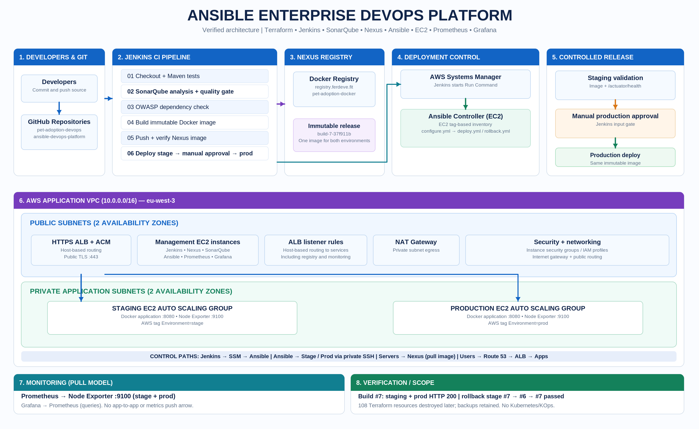
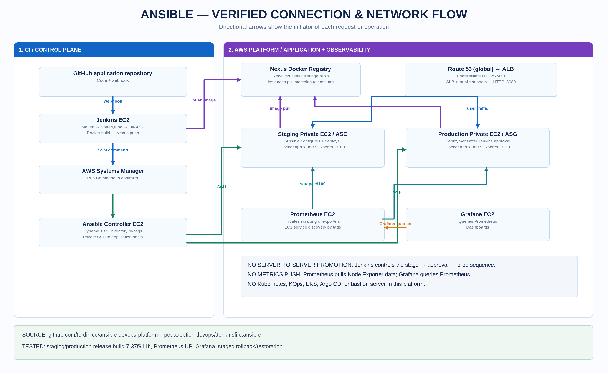
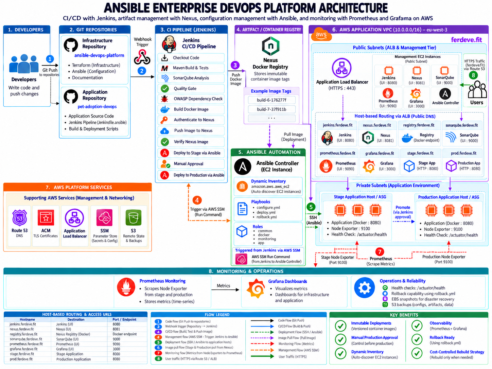

# Ansible Enterprise DevOps Platform

A hands-on AWS DevSecOps project that provisions infrastructure using Terraform and automates building, testing, scanning, publishing and deploying a containerised Spring Boot Pet Adoption application with Jenkins, Nexus and Ansible.

> **Current infrastructure status:** The live Ansible platform was intentionally destroyed after successful validation to control AWS costs. The Terraform state was emptied following a reviewed destroy plan. GitHub source code, a local recovery manifest, eight completed EBS snapshots and earlier S3 service backups were preserved. The endpoints below are *historical deployment endpoints*, not claims of current availability.

## Architecture

### Enterprise Platform Overview

### AWS Networking and Service Connections

### Combined Architecture

The diagrams represent the platform validated before its cost-control teardown. Terraform and Ansible source code remain authoritative where visual representations differ.

**Deployment:** GitHub → Jenkins → Maven, SonarQube and OWASP checks → Docker build → Nexus registry → AWS SSM → Ansible controller → staging and production EC2 instances.

**Application traffic:** Route 53 → HTTPS Application Load Balancer → staging or production target groups → Docker applications in private subnets.

**Monitoring:** Prometheus pulls metrics from staging and production Node Exporters on port `9100`. Grafana queries Prometheus for dashboards.

Terraform provisions the VPC, public/private subnets, NAT gateway, security groups, EC2 instances, Auto Scaling Groups, ALB, IAM and Route 53 records. Ansible uses private SSH to configure application hosts, while Jenkins uses AWS SSM to invoke the controller.

## Technologies

| Function | Implementation |
| --- | --- |
| Infrastructure as Code | Terraform, AWS |
| Networking | VPC, subnets, NAT gateway, security groups, ALB, Route 53, ACM |
| CI/CD orchestration | Jenkins |
| Build and automated tests | Maven |
| Code quality and dependency review | SonarQube quality gate, OWASP Dependency Check |
| Images and registry | Docker, Nexus Repository |
| Configuration and deployment | Ansible, AWS EC2 dynamic inventory, AWS SSM |
| Runtime | EC2, Docker, staging/production Auto Scaling Groups |
| Observability | Prometheus, Node Exporter, Grafana |

## Repositories

- **Infrastructure and operations:** [ansible-devops-platform](https://github.com/ferdinice/ansible-devops-platform)
- **Application and CI/CD pipeline:** [pet-adoption-devops](https://github.com/ferdinice/pet-adoption-devops), branch `feature/ansible-nexus-pipeline`, file `Jenkinsfile.ansible`

## Delivery workflow

1. Jenkins checks out the application commit and creates an immutable image tag, such as `build-7-37f911b`.
2. Maven runs the build and tests; SonarQube analysis, the quality gate and OWASP dependency checking run in the pipeline.
3. Jenkins builds the Docker image and publishes it to `registry.ferdeve.fit/pet-adoption-docker`.
4. Jenkins discovers the dedicated Ansible controller by AWS tags and invokes it through SSM Run Command.
5. Ansible discovers the target EC2 instances using project/environment tags. `configure.yml` applies the `common`, `docker` and `monitoring` roles; `deploy.yml` applies the `app` role.
6. The app role pulls the selected image, starts the container, and checks `/actuator/health`.
7. After staging succeeds, Jenkins requires manual approval before deploying the **same image tag** to production.

Rollback is performed by `module/ansible/playbooks/rollback.yml`, supplying a previously published `app_image_tag`. It reuses the application role instead of rebuilding the artifact.

## Validation performed

During the October 2026 live deployment, we verified:

- Jenkins Build #7 completed staging and approved production deployment successfully.
- Both staging and production ran image `registry.ferdeve.fit/pet-adoption-docker:build-7-37f911b`.
- Both `https://stage.ferdeve.fit/actuator/health` and `https://prod.ferdeve.fit/actuator/health` returned HTTP 200.
- Prometheus showed staging and production Node Exporter targets `UP`; Grafana displayed their system metrics.
- A controlled **staging-only** rollback to `build-6-176277f` succeeded, including direct Docker image inspection and health checks, followed by restoration to Build #7.
- Terraform destroy was reviewed and executed, with **108 managed resources destroyed** and no resources remaining in the final Terraform state.

**Validation limits:** Production rollback and complete snapshot-based disaster recovery were **not** exercised end-to-end. The eight EBS snapshots completed, but this does not establish application-consistent recovery. Existing S3 archives predate the final deployment.

## Documentation

- [Technical documentation](docs/ANSIBLE_ENTERPRISE_DEVOPS_PLATFORM_DOCUMENTATION.md)
- [Original deployment design](docs/superpowers/specs/2026-09-12-ansible-deployment-design.md)
- [Original implementation plan](docs/superpowers/plans/2026-09-12-ansible-deployment-implementation.md)
- [CI/CD release design](docs/superpowers/specs/2026-10-04-cicd-release-pipeline-design.md)

The `docs/superpowers/` files record **design intent**; the implementation and validated behaviour in the repository take precedence where they differ.

## Infrastructure and recovery notes

The Terraform root uses a remote S3 backend in `eu-west-3` (`ansible-devops-platform-tfstate-740994137090`, key `platform/terraform.tfstate`). The remote backend and separate service-backup bucket are outside the reviewed 108-resource destroy plan.

The recovery manifest and exported Terraform state were saved **locally**, intentionally excluded from Git, and should be retained securely. Restoring the environment will require Terraform provisioning and explicitly restoring required service data and configurations from recovery materials; `terraform apply` alone does not mount past EBS snapshots.

**Security:** Never commit `.tfstate` files, private keys, passwords, AWS credentials, secret parameters, or backup archives. Review IAM and SSM access before restoring a live environment.

## Project status

The implementation and stage-to-production delivery path were validated before cost-control teardown. Documentation and repository cleanup are ongoing. This is a portfolio/lab environment, not a currently running production service.
